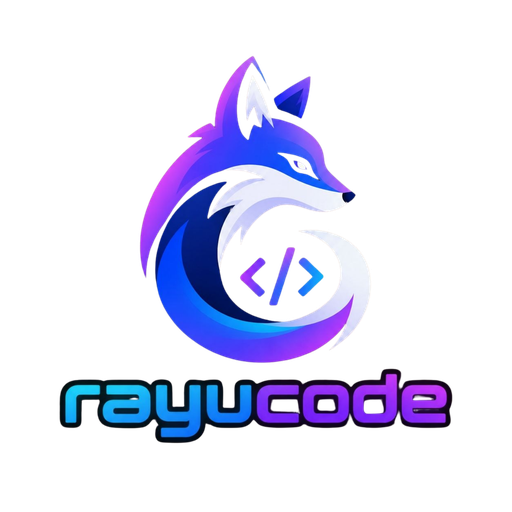

<div align="center">



# RayuCode (`rayu`)

RayuCode is based on [Jcode](https://github.com/1jehuang/jcode) by Jeremy Huang.
See the [MIT license](LICENSE) and [third-party notices](THIRD_PARTY_NOTICES).

<p>
  <strong>High-performance coding agents.</strong><br>
  Run dozens of agents in parallel without melting your machine. More agents, less RAM, no lag.
</p>

[](https://github.com/Choeng-Rayu/rayucode-v2/releases/latest)
[](https://github.com/Choeng-Rayu/rayucode-v2/commits/main)
[](https://github.com/Choeng-Rayu/rayucode-v2/stargazers)

</div>

<div align="center">

## Installation

</div>

```bash
# Linux & macOS (x86_64 and ARM64)
curl -fsSL https://rayucode.com/install | bash

# Or directly from GitHub:
curl -fsSL https://raw.githubusercontent.com/Choeng-Rayu/rayucode-v2/main/scripts/install.sh | bash
```

```powershell
# Windows (PowerShell — x64 and ARM64)
irm https://rayucode.com/install.ps1 | iex

# Or directly from GitHub:
irm https://raw.githubusercontent.com/Choeng-Rayu/rayucode-v2/main/scripts/install.ps1 | iex
```

Prebuilt binaries and `SHA256SUMS` for Linux, macOS, and Windows are published on [GitHub Releases](https://github.com/Choeng-Rayu/rayucode-v2/releases/latest).

<div align="center">

## Benches

</div>

Measure headless memory usage on your build with
[`scripts/bench_headless_memory.py`](scripts/bench_headless_memory.py).

<div align="center">

## Screenshots

[Browse the interactive gallery on rayucode.com](https://rayucode.com/#screenshots).

<table>
  <tr>
    <td align="center"><a href="https://rayucode.com/screenshots/inline-image-rendering.webp"></a><br>Inline images</td>
    <td align="center"><a href="https://rayucode.com/screenshots/resume-menu.webp"></a><br>Resume menu</td>
  </tr>
  <tr>
    <td align="center"><a href="https://rayucode.com/screenshots/latex-math-rendering.webp"></a><br>Inline LaTeX</td>
    <td align="center"><a href="https://rayucode.com/screenshots/cache-cold-notification.webp"></a><br>Cache cold notification</td>
  </tr>
</table>

</div>

## Swarm

Spawn two or more agents in the same repo, and they will automatically be managed by the server to allow native collaboration. When agent A edits a file that agent B has read (code shifting under its feet), the server notifies agent B. Agent B can ignore it if it is not relevant, or it can check the diff to make sure that it doesn't conflict. Each agent has messaging abilities, capable of DMing just one agent, broadcasting to all other agents hosted by the server, or just agents working in that repo. This allows you to spawn multiple sessions in the same repo, and have all conflicts automatically resolved.

Agents are also able to spawn their own swarms autonomously. They have a swarm tool which allows them to spawn in their own teamates to accomplish tasks in parallel. Doing so turns the main agent into a coordinator and the spawned agents into workers. Groups of agents, their messaging channels, their completion statuses, etc are all automatically managed. This can be done headlessly or headed.


## OAuth and Providers

Sign in with **Rayu** for hosted models, or bring your own API keys for
[supported providers](https://rayucode.com/docs#providers).

### Quickstart auth

```bash
# Recommended: browser loopback login to your Rayu/RayuCode account.
# The session is shared with the Rayu CLI at ~/.rayu/rayu-auth.json.
rayu login --provider rayu

# Or use a Rayu API key (no browser needed):
export RAYU_API_KEY=rayu_sk_live_...

# Then run a prompt against the live Rayu model catalog:
rayu --provider rayu run "Say hello from rayu"
```

Rayu models are discovered live from your account entitlements (or the gateway
catalog for API keys), so new models appear without a `rayu` update. See
[OAUTH.md](OAUTH.md) for the full auth contract, env overrides, and other providers.

## Telegram remote

Pair the shared Rayu bot with `rayu telegram link` after signing into your
Rayu account, or pair a dedicated BotFather bot with
`rayu telegram link --botfather`. Open the pairing link or scan the QR code
in a private Telegram chat. In the terminal UI, `/telegram-bot` starts pairing
with the shared bot when disconnected. Use `/telegram-bot status` to check
the link. To move an existing hosted link from the legacy CLI, run
`rayu telegram link --replace-existing`. This disconnects the old chat before
creating the new pairing.

Use `/sessions` to select a session, then send a prompt or an image. Use
`/model` and `/provider` to choose among configured routes, `/interrupt` to
cancel a Telegram turn, and `/stop` to disconnect. The bot can request
approval for tool use or a plan and ask you a question. You can also review
these requests on the host with `rayu permissions`. Run `rayu login` on the
host when `/connect` prompts you to set up a provider.

`rayu telegram status` and `rayu telegram disconnect` manage the link from
the host. A BotFather bot can receive generated images and MP4 files. The
shared bot sends a text notice for generated media.

Remote uninstall is disabled by default. `rayu telegram uninstall enable`
enables it locally for a managed Unix CLI install. In Telegram, use `/status`
to find the device ID, then send `/uninstall <device-id>` and review the
confirmation. The operation removes the running managed payload and its
launcher links while preserving projects and Rayu session data.

## Customizability / Self-Dev

RayuCode is inventing a new form of customizability. One that doesn't limit you to what a plugin or extension can do. Tell your `rayu` agent to enter self dev mode, and it will start modifying its own source code. RayuCode is optimized to iterate on itself. There is significant infrastructure around self development, which allows it to edit, build, and test its own source code, then reload its own binary and continue work in your (potentially many) sessions, fully automatically.


<!-- Add self-dev demo thumbnail/video and fuller writeup here. -->

## Other

- [Token optimization](docs/HARNESS.md#token-optimization)
- [KV cache](docs/HARNESS.md#kv-cache)
- [Hill-climbable measurements](docs/HARNESS.md#hill-climbable-measurements)
