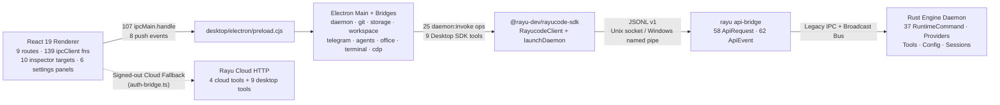

# RayuCode Desktop–Rust Engine Deep Architectural Audit & Gap Remediation Plan

**Audit baseline:** `/home/rayu/rayu/rayucode-v2` (branch `rayu`, HEAD `107aa8a`)  
**Engine target:** `rayucode-daemon` / `rayu api-bridge` (`crates/rayucode-protocol`, `crates/rayucode-harness-api`, `crates/rayucode-harness-api-server`, `crates/rayucode-app-core`, `src/cli/`)  
**Desktop stack:** Electron Main + Preload + `sdk/typescript` (`@rayu-dev/rayucode-sdk`) + React 19 UI (`desktop/`)

---

## 1. Executive Summary

RayuCode Desktop uses the local Rust coding engine (`rayu api-bridge` talking JSON Lines v1 over Unix domain socket / Windows named pipe to the shared or private `rayucode` daemon) through `sdk/typescript` (`@rayu-dev/rayucode-sdk`) wrapped by Electron's `DaemonClient` (`desktop/electron/daemon-client.ts`) and 107 typed `ipcMain.handle` channels exposed to React via `preload.cjs` and `ipcClient` (`desktop/src/lib/ipc-client.ts`).

The deep code audit across Rust engine crates, TypeScript SDK, Electron Main/Preload bridges, and React UI identified **20 architectural & integration defect clusters (`D1`–`D20`)**, including all 5 baseline findings (`D1`–`D5`) plus 15 newly discovered mismatches spanning session lifecycle, Windows transport, provider catalog refresh, Electron IPC security, Git status/discard safety, Office/CDP Fidelity, Playwright-grade UI parity with `prototype/`, and local mock fallbacks posing as live engine data.

---

## 2. Exact Verified Surface & Protocol Census

| Surface / Layer | Source of Truth | Exact Verified Count | Notes |
|---|---|---|---|
| React Routes (`ROUTES`) | `desktop/src/config/routes.ts` | **9** | `home`, `workspace`, `swarm`, `agents`, `automations`, `plugins`, `changes`, `telegram`, `settings` |
| Dead Orphan Shell Files | `desktop/src/components/shell/` | **3** | `daemon-banner.tsx`, `dual-mode-top-bar.tsx`, `session-pane.tsx` (0 importers; duplicate live `DaemonBanner.tsx`, `TopBar.tsx`, `LeftSidebar.tsx`) |
| `ipcClient` Functions | `desktop/src/lib/ipc-client.ts:4107-7423` | **139** | 124 with production React callers + 15 preload/tool/test/alias helpers (`inspector.runTerminalCommand`, `plugins.toggleSkill`, `changes.createPullRequest`, `cloud.streamChat`, `cloud.cancelStream`, `terminal.ptyCreate`, `office.readExcel`, `office.createPowerPoint`, `browser.{navigate,snapshot,click,type,screenshot}`, `fileChanges.get`, `todos.get`) |
| Electron `ipcMain.handle` Channels | `desktop/electron/main.ts:207-1158` | **107** | 1:1 with `desktop/electron/preload.cjs` `ipcRenderer.invoke` (0 drift) |
| Electron `webContents.send` Push Events | `desktop/electron/main.ts` | **8** | `rayu:daemon:status-changed`, `rayu:harness:event`, `rayu:terminal:pty-data`, `rayu:terminal:pty-exit`, `rayu:auth:changed`, `rayu:storage:sidebar-changed`, `rayu:desktop:artifact`, `rayu:browser:ensure-open` |
| Generic `rayu:daemon:invoke` Ops | `desktop/electron/daemon-client.ts:1798-1895` | **25** | `sessions.{list,create,attach,fork,history,send,softInterrupt,cancelSoftInterrupts,cancel,permission,setPermissionMode,compact}`, `models.{runtimeInfo,list,setModel,setEffort}`, `capabilities.get`, `config.{get,patch}`, `runtime.command`, `fileChanges.{get,diff,action}`, `todos.get`, `previews.setBrowserBounds` |
| Registered Desktop SDK Tools | `desktop/electron/desktop-tools.ts:41-256` | **9** | `read_excel`, `write_excel`, `create_powerpoint`, `list_templates`, `save_template`, `browser_navigate`, `browser_snapshot`, `browser_click`, `browser_type` (+ 4 Cloud-only tools in `auth-bridge.ts:326-387`: `list_files`, `read_file`, `search_files`, `run_command`) |
| Rust `ApiRequest` Variants | `crates/rayucode-harness-api/src/requests.rs:45-442` | **58** | 57 concrete requests (`35` `REQUIRES_ATTACH` + `22` global) + `Unknown` wire fallback |
| Rust `ApiEvent` Variants | `crates/rayucode-harness-api/src/events.rs:10-561` | **62** | 61 concrete events + `Unknown` wire fallback |
| Rust `RuntimeCommand` Variants | `crates/rayucode-harness-api/src/runtime_commands.rs:8-44` | **37** | Mix of session-scoped (e.g. `Context`, `Cache`, `Info`, `Review`, `Judge`) and inherently global operations (`Telegram`, `Agents`, `SubagentModel`, `Swarm`, `Overnight`, `Schedules`, `Mcp`, `Skills`, `Memory`, `RefreshModelList`, `ServerReload`) |
| Curated Slash Commands | `crates/rayucode-harness-api-server/src/capabilities.rs:30-301` | **28** | Advertised via `Capabilities.slash_commands` (`compact` through `search`) |

---

## 3. Complete Defect Register (`D1`–`D20`)

### D1. Global Status Reads Create Phantom `"Telegram Remote"` Chats (P0)
- **Root Cause:** `DaemonClient.runRuntimeCommandOnAnySession()` (`desktop/electron/daemon-client.ts:1553-1576`) picks `this.attachedSessionId`, or `listSessions({ limit: 1 })`, and when empty calls `this.createSession(..., "Telegram Remote")`. `TelegramBridge.getState()` (`desktop/electron/telegram-bridge.ts:155-280`) runs two concurrent `/telegram` + `approvals` calls during polling/hover/opening, creating up to two empty `"Telegram Remote"` chats on an empty store. `AgentsBridge.runCommand()` (`desktop/electron/agents-bridge.ts:167-180`) and MCP reload IPC handlers (`desktop/electron/main.ts:660-687`) share the same helper.
- **Required Fix:**
  1. Add `ApiRequest::GlobalRuntimeCommand { command, args }` in `rayucode-protocol`, `rayucode-harness-api`, `rayucode-harness-api-server`, and `rayucode-app-core` (capability `global_runtime_commands`), plus `RuntimeCommand::supports_global_scope()`.
  2. Expose `RayucodeClient.globalRuntimeCommand()` in `sdk/typescript/src/client.ts`.
  3. Add `DaemonClient.runGlobalRuntimeCommand()` in `desktop/electron/daemon-client.ts`; restrict `runRuntimeCommandOnAnySession()` strictly to never auto-create sessions for reads (or explicit opt-in session creation when user explicitly invokes a session-creating workflow).
  4. Route Telegram state/mode/approvals/uninstall, global Agents config, global Swarm/Overnight/Schedules reads, and MCP reloads through `runGlobalRuntimeCommand()`.

### D2. Git Changes Caps at 40 Files & Mis-parses Quoted/Rename ` -> ` Paths (P0)
- **Root Cause:** `getGitChanges()` (`desktop/electron/git-bridge.ts:342-465`) runs `git status --porcelain=v1 -uall` without `-z`, splits rename records with `.split(" -> ")` (`L368-370` — breaking any filename containing literal ` -> ` such as `a -> b.rs`), fails to unquote Git C-escaped paths, caps the result at `entries.slice(0, 40)` (`L379`), runs eager `git diff` across all entries, and in `discardGitFile()` (`L492-513`) executes `git checkout HEAD -- <file>`, which destroys staged index changes; `checkoutGitBranch()` (`L244-287`) returns `{ ok: true, keptWorkingTree: true }` even when `git checkout` failed on a dirty working tree.
- **Required Fix:** Switch to `git status --porcelain=v1 -uall -z`, implement a full NUL-delimited parser (extracting `staged`, `unstaged`, exact path, and original path for `R`/`C` records), return all changed files with `totalChangedFiles`, load full diffs lazily per file (plus bounded `diff` preview), use explicit staged vs unstaged discard (`git restore --worktree` vs index reset), and return `{ ok: false }` with typed error on dirty branch checkout failure.

### D3. MCP Edit Clobbers Existing Fields & Secrets (P0)
- **Root Cause:** `upsertLocalMcpServer()` (`desktop/electron/storage-bridge.ts:685-736`) constructs a fresh `const serverEntry: Record<string, unknown> = {}` and overwrites `mcpServers[id] = serverEntry`, dropping untouched `headers`, `env`, `timeout`, `type`, or custom fields; `ExtensionUpsertMcpSchema` (`desktop/electron/ipc-schemas.ts:377-384`) omits `headers`, `timeout`, `type`, and `expectedRevision`. `removeLocalMcpServer()` (`storage-bridge.ts:738-769`) only inspects `.mcp.json` and `~/.rayu/mcp.json`, missing `~/.mcp.json`.
- **Required Fix:** Spread/merge existing server entry fields, patch only explicitly supplied fields (and support explicit clear flags), carry revision tokens (`sha256` / `mtimeMs`) through Zod schemas and reject stale overwrites, search all three MCP config files (`workspace/.mcp.json`, `~/.rayu/mcp.json`, `~/.mcp.json`), and return both `diskSaved` and `daemonReloaded` status separately.

### D4. Malformed `.mcp.json` Silently Overwritten as Empty (P0)
- **Root Cause:** `readJsonFile()` (`desktop/electron/storage-bridge.ts:170-177`) catches JSON parse failures and returns `{}`. Subsequent writes via `writeJsonFile()` (`L179-191`) perform a non-atomic `fs.writeFile` that wipes the user's malformed file without warning.
- **Required Fix:** Introduce strict `readJsonFileStrict()` returning typed parse errors preserving original bytes on disk; block mutating saves on malformed `.mcp.json` with a repairable error detailing path + syntax failure; write valid updates atomically (temp file + rename).

### D5. Signed-Out Private Daemon Accepts Turns (`MessageAccepted`) Without Failing Promptly (P0)
- **Root Cause:** `crates/rayucode-app-core/src/server/client_lifecycle.rs:1599` writes `ServerEvent::Ack { id: request.id() }` unconditionally *before* `start_processing_message` at `client_processing.rs:231` evaluates `crate::rayu::auth_gate_active()` or provider readiness. `crates/rayucode-harness-api-server/src/translate.rs:3416` translates that `Ack` into `ApiEvent::MessageAccepted`, leaving `client.sendTurn()` (`sdk/typescript/src/client.ts:741-797`) believing the turn started; furthermore, non-strict `sendTurn()` ignores mid-stream `ev:"error"` frames and signed-out empty `MultiProvider` failures can fail silently or leave UI thinking the turn succeeded while clearing the composer draft.
- **Required Fix:** Check effective provider readiness (`auth_gate_active()` / initialized provider availability) *before* sending `ServerEvent::Ack` on interactive message submission in `client_lifecycle.rs` / `client_processing.rs`; fail immediately with a typed auth/provider error (`ErrorCode::AuthRequired` / `Unavailable`); make `sendTurn()` surface server `error` frames as rejected promises; preserve the Desktop composer draft in `composer.tsx` / `HomeView` / `trace.sendPrompt` whenever send/turn acceptance fails.

### D6. `rayuHome` vs `RAYU_HOME` Split-Brain + Orphaned Daemon Lifecycle & Windows Pipe Readiness (P0)
- **Root Cause:** `DaemonClient.launchAndConnect()` (`desktop/electron/daemon-client.ts:682-687`) passes `rayuHome: instanceHome` AND `env: { RAYU_HOME: canonicalHome }`. Inside `sdk/typescript/src/launch.ts:566-576`, `...options.env` overrides `RAYU_HOME`, causing the spawned daemon to record its PID in `~/.rayu/servers.json` while `readDaemonPidSync(rayuHome, runtimeDir)` (`launch.ts:347`) inspects `~/.rayu/desktop-instance/servers.json` and returns `undefined`. `launch.ts:537,746` also hardcodes `isUnixSocketPath` / Unix socket assumptions on Windows named pipes (`\\.\pipe\...`), `reapOnExit()` (`L696`) kills process groups unconditionally (even with background jobs), and `main.ts:1369-1374` calls `before-quit` synchronously without awaiting `daemonClient.shutdown()`.
- **Required Fix:** Separate credential/data home (`RAYU_AUTH_CONFIG_DIR` / `RAYU_DATA_HOME`) from runtime socket/instance home (`rayuHome`); ensure `launch.ts` uses effective `RAYU_HOME`, probes Windows named pipes correctly (`transport.ts` + `launch.ts`), adds `allowSignedOut` private daemon bootstrap (`RAYU_DEFERRED_AUTH_BOOTSTRAP`), avoids reaping shared or overnight-active daemons, and awaits async `daemonClient.shutdown()` in `main.ts` `before-quit`.

### D7. Engine Auth Gate Blocks Signed-Out Inspection & `checkConnection` Skips Private Launch (P1)
- **Root Cause:** `DaemonClient.checkConnection()` (`desktop/electron/daemon-client.ts:723-787`) gates auto-launch on `hasLocalRayuCredentials()`. Meanwhile `App.tsx` / `SideChatDrawer` / settings panels expect local engine metadata (capabilities, config schema, models) even when signed out, and re-signing in after sign-out does not automatically restart or notify attached sessions cleanly.
- **Required Fix:** Allow signed-out private local daemon inspection (`allowSignedOut`) for read/metadata/inspection routes while gating inference turns cleanly at D5, and synchronize `notifyAuthChanged` + query invalidation on both Electron and Rust daemon sides.

### D8. 4 Rust Providers Lack `refresh_model_catalog` & Hardcode Stale Lists (P1)
- **Root Cause:** `crates/rayucode-provider-openai-runtime`, `crates/rayucode-provider-gemini-runtime`, `crates/rayucode-provider-cursor-runtime`, and `crates/rayucode-provider-antigravity-runtime` implement `prefetch_models` but omit `refresh_model_catalog`, so forced catalog refresh (`models.refresh` / `/refresh-models`) falls back to stale cache or trait default.
- **Required Fix:** Implement explicit `refresh_model_catalog` (cache-bypass on force + last-good catalog retention on transient failure) across all 4 runtimes with regression tests discovering an arbitrary future model absent from static fallback arrays.

### D9. `Config` Reload Lack Confirmed RPC Ack & Cross-Bridge Sync (`D9`) (P1)
- **Root Cause:** `crates/rayucode-harness-api-server/src/lib.rs:282` keeps `config_tx` per bridge process only; `PatchConfig` / `RuntimeCommand::ServerReload` lack confirmed propagation across independent clients or daemon reload confirmation.
- **Required Fix:** Wire daemon-backed config reload confirmation (`ServerReload` / `PatchConfig`) and ensure `ConfigChanged` broadcasts reach active Desktop listeners and trigger `settings` / `agents` / `models` query invalidation.

### D10. Electron Main Security Gaps & Renderer Error Swallowing (P1)
- **Root Cause:** Zero `senderFrame` / origin validation across all 107 `ipcMain.handle` registrations in `desktop/electron/main.ts:207-1158`; `<webview>` (`webviewTag: true`, `L1265`) enabled without `will-attach-webview` handler stripping preload/nodeIntegration/unsafe schemes; `openExternal` (`native-bridge.ts:164-171`) lacks `http:`/`https:` scheme allowlist; `resolveSafeWorkspacePath` (`auth-bridge.ts:125-132`, `workspace-bridge.ts:51-64`) does not use `fs.realpathSync` (vulnerable to workspace symlink escapes); `executeRunCommandTool` (`auth-bridge.ts:254-279`) executes unapproved `/bin/sh -lc`; `main.ts:234,250,335` swallows daemon errors into `[]`/`false`; `HarnessSendMessageSchema` (`ipc-schemas.ts:174-183`) lacks combined attachment payload cap.
- **Required Fix:** Enforce trusted `senderFrame` origin check on every IPC handler, attach `will-attach-webview` hardening + `web-contents-created` popup guard, enforce `http:`/`https:` scheme check on `openExternal`, add `realpathSync` containment checks, propagate typed IPC errors instead of silent `[]`, enforce 20 MB combined attachment cap, and restrict `auth-bridge` cloud tool fallback cleanly.

### D11. Office & Workspace File Fidelity Bugs (`office-bridge.ts`, `workspace-bridge.ts`, `desktop-tools.ts`, `native-bridge.ts`) (P1)
- **Root Cause:**
  1. `writeRealExcelWorkbook` (`desktop/electron/office-bridge.ts:208-333`) rebuilds workbooks from scratch, destroying untouched worksheets, styles, and charts, and multiplies already-decimal percent values by `100` (`L294-297`) causing 100× corruption.
  2. `readRealExcelWorkbook` (`L117-206`) truncates at 26 columns / 250 rows, skips blank columns, marks entire formula rows as totals, and `extractPrimitiveCellValue` (`L81-115`) turns objects/errors into `[object Object]` or `0`.
  3. `readWorkspaceFile` (`desktop/electron/workspace-bridge.ts:87-115`) does not check NUL/binary bytes, ignores `bytesRead`, splits multi-byte UTF-8 sequences at the 256 KB boundary, and returns no `truncated` flag.
  4. `desktop-tools.ts` has invalid JSON schemas (`write_excel` `L80-88`: `headers` missing `type`, `rows` missing `items`; `save_template` `L197` missing `prompt_spec` in `required`), `normalizeExcelSheets` (`L279-423`) treats formula strings in object cells literally, and `buildDesktopSdkTools` (`L643-655`) ignores `context.signal` (`AbortSignal`) and lacks session/workspace scoping.
  5. `native-bridge.ts` (`openInExcel` `L32-116`) silently creates demo `.xlsx` files on missing paths, and `openInVSCode` (`L148-162`) lacks `~/` expansion, `cwd` resolution, and Windows `code.cmd` support.
  6. `ipc-schemas.ts` `OpenInPowerPointPayloadSchema` (`L12-29`) strips `filePath`, `metrics`, and `layout`.
- **Required Fix:** Preserve existing workbook sheets/styles via load-and-patch, normalize percent inputs without 100× drift, report truncation metadata cleanly in Excel & workspace reads, handle UTF-8 boundaries safely, fix tool JSON schemas & `AbortSignal` & workspace scoping, preserve `OpenInPowerPointPayloadSchema` fields, and remove implicit demo workbook synthesis.

### D12. Terminal PTY Process Leak, UTF-8 Tear & Windows Compatibility (`terminal-bridge.ts`) (P1)
- **Root Cause:** `PTY_DRIVER_PY` (`desktop/electron/terminal-bridge.ts:98-182`) installs no `SIGTERM` handler and does not reap/kill process groups (`killpg` + `waitpid`). `TerminalPtyManager` (`L205-323`) lacks `StringDecoder` (corrupting multi-byte UTF-8 across chunks), suffers stale `onExit` race conditions across recreated IDs, and falls back to raw piped `cmd.exe` without PTY framing on Windows.
- **Required Fix:** Add process-group signal teardown + `waitpid` reap in `PTY_DRIVER_PY`, `StringDecoder("utf8")` buffering + monotonic generation IDs on `onExit` in `TerminalPtyManager`, and explicit Windows fallback diagnostics / clean shutdown.

### D13. Browser CDP Debugger Leak & `localhost` TLS Rewrite (`browser-cdp.ts`) (P1)
- **Root Cause:** `browser-cdp.ts:1-380` attaches Electron's CDP `debugger` and never detaches it, looks up the first global `<webview>` regardless of active session/tab, caches stale `refToBackendNodeId`, silently caps AX tree output at 160 lines (`L199`), and rewrites `localhost` URLs to `https://localhost` (`L112-114`) breaking standard local HTTP dev servers.
- **Required Fix:** Preserve `http://` for `localhost` / `127.0.0.1`, manage per-webContents debugger lifecycle with clean idle/close detach + error recovery, refresh/invalidate stale AX refs before click/type, and indicate truncated AX snapshots.

### D14. Per-Session State Contamination (`DaemonClient`, `main.ts`, `App.tsx`) (P1)
- **Root Cause:** `main.ts:174` tracks a single global `activeWorkspaceDir`; `DaemonClient` (`daemon-client.ts`) shares global permission/session routing and `App.tsx:321-405` stores/clears permissions across single `pendingPermission` expectations or falls back incorrectly when multiple sessions stream concurrently. Also `ipcClient.trace.sendPrompt` + `App.tsx` can leave permission mode out-of-sync when starting the first turn.
- **Required Fix:** Key active workspace/permission/session state cleanly by `sessionId`, `await` `setPermissionMode` before `sendMessage` on first-turn home/workspace submit, and isolate concurrent session events/approvals/errors by `sessionId`.

### D15. Composer Draft Loss on Failed Turn & Missing `QuestionRequest` UI Wiring (P1)
- **Root Cause:** `composer.tsx` clears input optimistically before guaranteed turn acceptance; additionally, Rust `ApiEvent::QuestionRequest` / `QuestionClosed` + `ApiRequest::QuestionResponse` are completely unwired in `DaemonClient`, `main.ts`, `ipcClient`, and React (`ClarifyingQuestionCard` in `desktop/src/features/sessions/components/clarifying-question-card.tsx` exists as an isolated component not wired to live daemon `question_request` events!).
- **Required Fix:** Wire `QuestionRequest` / `QuestionClosed` / `QuestionResponse` end-to-end (Rust -> SDK `respondToQuestion` -> `DaemonClient` -> `main.ts` -> `ipcClient` -> `ChatStream` + `ClarifyingQuestionCard`), and preserve composer draft + attachments on any rejected `sendPrompt` / D5 auth failure.

### D16. Inexact Turn Fork & Missing `ApiRequest::ForkSession` Boundary (`turn-actions.tsx`, `daemon-client.ts`) (P1)
- **Root Cause:** `TurnActions` (`desktop/src/features/execution-trace/components/turn-actions.tsx:153`) and `ipcClient.trace.forkTurn` / `DaemonClient` call `forkSession` without passing the user's selected turn/message boundary (`up_to_message_index` / `up_to_message_id`), so branching from an earlier message forks the entire latest conversation instead of that exact point.
- **Required Fix:** Add optional `up_to_message_index` / `up_to_message_id` to Rust `ApiRequest::ForkSession` + `split` logic (`exact_session_fork` capability), forward in `sdk/typescript`, `DaemonClient`, `main.ts`, `ipcClient`, and `TurnActions`.

### D17. Fake/Mock Data Posing as Live Engine Operations (`swarm`, `automations`, `floating-ask-chat`, `SideChatDrawer`) (P0/P1)
- **Root Cause:**
  1. `swarm` and `automations` (`ipc-client.ts:5422-5622`) synthesize or overlay local mock/preview agent rosters, overnight runs, and schedule toggles instead of gating on real Rust `GlobalRuntimeCommand` / capability state (`Swarm`, `Overnight`, `Schedules`).
  2. `FloatingAskChat` (`previews/components/floating-ask-chat.tsx`) and `SideChatDrawer` (`components/shell/SideChatDrawer.tsx`) submit prompts through mocked local replies or unattached stubs instead of real Rust daemon streaming (or explicit ephemeral side chat).
- **Required Fix:** Back Swarm & Automations (`Overnight` + `Schedules`) with real `runGlobalRuntimeCommand` queries and capability gates (showing an explicit unavailable state when unsupported rather than fake data); route `SideChatDrawer` and `FloatingAskChat` through real engine sessions / `trace.sendPrompt` with visible provenance.

### D18. Desktop UI / `DESIGN.md` Visual Regressions & Dead Shell Files (P1)
- **Root Cause:**
  1. `desktop/src/styles/globals.css:98` sets `--sidebar-w: 316px;` instead of `DESIGN.md` Section 4 `296px` (`52px` rail + `244px` pane).
  2. `desktop/src/config/navigation.ts:10-22` shows `"agents"` (`Agents & Personas`) in rail slot #2 instead of `DESIGN.md` Top-6 primary item `"swarm"` (`Swarm`), pushing Swarm out of the primary rail.
  3. Three dead duplicate shell files remain on disk (`desktop/src/components/shell/daemon-banner.tsx`, `dual-mode-top-bar.tsx`, `session-pane.tsx`) with zero importers.
- **Required Fix:** Restore `--sidebar-w: 296px;` in `globals.css`, restore `Swarm` in `PRIMARY_NAV_ITEMS` slot #2 matching `DESIGN.md` (with `Agents & Personas` accessible cleanly from Swarm/Settings/secondary entry), and remove the 3 dead files.

### D19. Inspector, Changes, Previews, Plugins, Telegram, Agents & Settings Refresh/Shortcut Desyncs (P2)
- **Root Cause:**
  - `ContextPanel` / `DiffTabPanel` / `CodeViewer` (`features/inspector/`) and `ChangesView` (`features/changes/`) mix workspace git files vs session file-change tracking without clear source reconciliation or stale query invalidation after `fileChanges.action`, `commitStaged`, or `checkoutBranch`.
  - `TelegramView`, `AgentsView`, `PluginsView`, `SettingsView` mutate daemon/disk config via one-off calls without invalidating shared TanStack Query caches (`models`, `capabilities`, `config`, `plugins`, `agents`, `telegram`), and Settings server reload lacks confirmation feedback; shortcut list in `SettingsView` must stay 1:1 with `AppShell` handlers.

### D20. Cloud Fallback (`auth-bridge.ts`) Security & Parity Gaps (P2)
- **Root Cause:** When signed out or on Cloud chat stream, `auth-bridge.ts`: (1) leaves active SSE streams running on `signOut` (`L1097-1117`); (2) executes `run_command` via raw `/bin/sh -lc` (`L254-279`) without command approval or timeout clarity; (3) uses `path.resolve` without `realpathSync` (`L125-132`).
- **Required Fix:** Abort all `activeStreams` in `signOut()`, harden workspace path containment with `realpathSync`, and guard `run_command` cleanly with cwd confinement, timeout, and structured error/approval checks.

---

## 4. Non-Negotiable Architecture & Implementation Contract Rules

1. **Zero Phantom Sessions on Global Operations:** Global queries (`telegram`, `agents global`, `subagent_model global`, `swarm`, `overnight`, `schedules`, `mcp`, `skills`, `memory`, `refresh_model_list`, `server_reload`) MUST execute over `ApiRequest::GlobalRuntimeCommand` (`supports_global_scope() == true`) and NEVER implicitly call `createSession`.
2. **Honest Turn Acceptance:** `ServerEvent::Ack` (`ApiEvent::MessageAccepted`) MUST NOT be emitted when auth/provider readiness checks fail; client `sendTurn()` MUST reject on protocol `Error` frames and UI MUST preserve user drafts & attachments on failure.
3. **Single Effective Home vs Auth Home Split:** Runtime socket/PID discovery (`servers.json`) uses effective `RAYU_HOME`, decoupled cleanly from `RAYU_AUTH_CONFIG_DIR` / user data dir, with proper Windows named pipe probing and async `before-quit` cleanup.
4. **No Fake Action Outcomes:** Every enabled button/toggle in React performs a real Rust daemon, Git, disk, or CDP operation, or renders an explicit unavailable/capability-gated reason. Mutating config/file writes use atomic write + revision check and fail closed on malformed JSON/dirty git checkouts.
5. **Visual & Architectural Fidelity (`DESIGN.md`):** Semantic Tailwind v4 tokens only (`--sidebar-w: 296px`, top-6 rail with `Swarm`, zero raw hex, zero arbitrary colors, zero emojis, strict `@/features/<name>` barrel imports, `<SectionErrorBoundary>` + `<Suspense>`).
