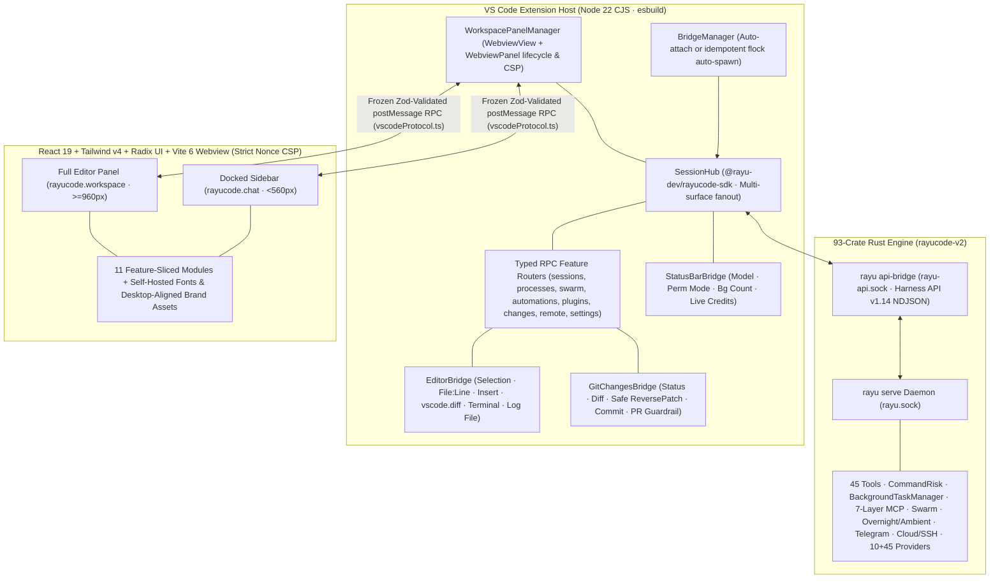

# RayuCode for VS Code — System Architecture (`ARCHITECTURE.md`)

> **Authority:** Grounded in `vscode/VSCODE_DESIGN.md`, `vscode/docs/PROTOCOL_CONTRACTS.md`, and the 10 page specs in `vscode/docs/pages/00..09-*.md`.
> **Isolation Boundary:** `desktop/` is never modified during VS Code extension development; `vscode/` shares the single 93-crate Rust engine (`rayu` daemon + `rayu api-bridge`), `@rayu-dev/rayucode-sdk`, and `@rayu-dev/rayucode-ui` state primitives.

---

## 1. End-to-End Runtime Topology



---

## 2. Three-Tier Layer Responsibilities

### 2.1 Tier 1 — Rust Engine (`rayu serve` + `rayu api-bridge`)
- Owns **100% of business logic, agent turns, tool execution, provider auth, secrets, MCP pooling, Swarm coordination, Overnight runs, Ambient cycles, Telegram/Gateway bridges, and BackgroundTaskManager**.
- Exposed to the Extension Host over local Unix socket / Windows named pipe (`rayu-api.sock`) speaking **Harness API v1.14 NDJSON** (`crates/rayucode-harness-api` + `crates/rayucode-harness-api-server`).
- Backed by strict additive compatibility: if an older v1.13 bridge is running, capability flags in `HelloOk` allow the Host and Webview to gracefully degrade unsupported controls with a quiet 1-line notice instead of crashing.

### 2.2 Tier 2 — VS Code Extension Host (`vscode/host/`)
Bundled as CommonJS for Node 22 via `esbuild` (`vscode/build.mjs`), keeping the host lean and strictly separated from browser code:

- **`vscode/host/harnessExtension.ts`:** Extension activation entrypoint registering views (`rayucode.chat`), panel commands (`rayucode.openWorkspacePanel`), editor context commands, status bar items, and lifecycle disposables.
- **`vscode/host/runtime/bridgeManager.ts`:** Resolves `rayu` binary (`rayucode.runtime.binaryPath`, `~/.local/bin/rayu`, `~/.rayu/builds/current/rayu`, `PATH`), attaches to an existing `rayu-api.sock`, or performs idempotent `flock`-guarded auto-spawn (`rayu api-bridge`), with exponential backoff reconnect and `Ping` latency measurement.
- **`vscode/host/runtime/sessionHub.ts`:** Single `@rayu-dev/rayucode-sdk` client instance inside the Host. Fans out `ApiEvent` frames and `BackgroundProcessView` snapshots to **both** the Compact Sidebar (`rayucode.chat`) and any open Full Editor Panel (`rayucode.workspace`), ensuring both surfaces stay in lockstep with zero duplicate daemon connections.
- **`vscode/host/runtime/rpcRouter.ts`:** Zod-validates every incoming `WebviewToHostMessage`, routes `rayucode.rpc.call` methods to typed domain handlers (sessions, background processes, swarm, automations, plugins/MCP/skills/memory, changes, remote/telegram, settings/doctor), and maps errors into `{ ok: false, code, error }` envelopes.
- **`vscode/host/bridges/editorBridge.ts`:**
  - Streams active editor file & line range changes (debounced 150ms) to webviews (`rayucode.editor.selectionChanged`) for the Composer `EditorSelectionPill`.
  - Executes `openFile(path, line, col)`, `openDiff(path, sessionId)` (`vscode.diff` in `ViewColumn.Beside`), `insertCode(code, "cursor" | "diff")`, `openTerminal(cwd)` (native VS Code Integrated Terminal), `openWorktreeWindow(path)` (`vscode.openFolder(..., true)`), `openMarkdownPreview(path)`, `openExternal(url)`, and clipboard copy.
- **`vscode/host/bridges/gitChangesBridge.ts`:** Combines workspace `git status` / diffs with session edit tracking and safe `vscode/host/review/reversePatch.ts` Keep/Undo (refusing to clobber subsequent manual user edits), staged commits, and explicit user-confirmed PR creation (`gh` / GitHub flow).
- **`vscode/host/bridges/statusBarBridge.ts`:** Manages quiet VS Code Status Bar items: active model & permission mode, active background process count (`Rayu · 2 bg`, hidden when 0), and live session credit indicator.
- **`vscode/host/panel/workspacePanelManager.ts`:** Manages `rayucode.chat` (`WebviewViewProvider`) and `rayucode.workspace` (`WebviewPanel`, `retainContextWhenHidden: true`), generates strict per-mount nonce CSP HTML, resolves `mediaBaseUri` via `webview.asWebviewUri(...)`, persists `theme`/`accent` in `globalState`, and handles seamless `⤢ Pop out` route/session handoff.

### 2.3 Tier 3 — Dual-Surface Webview (`vscode/webview/src/`)
Bundled by **Vite 6** with **React 19 + TypeScript + Tailwind CSS v4 + Radix UI + Zustand + TanStack Query v5**:

- **Single Bundle, Two Surfaces:** Both `rayucode.chat` (Sidebar) and `rayucode.workspace` (Editor Tab) mount the same `main.tsx` bundle, differentiated by `surface: "sidebar" | "editorPanel"` in `rayucode.host.init` and CSS container queries (`@container/app`: `< 560px` Compact, `560–959px` Medium, `>= 960px` Wide).
- **Streaming & Render Performance:**
  - Live `rayucode.harness.frame` events pass through `createStreamBatcher(16ms)` (rAF frame coalescing) into the Zustand store + `@rayu-dev/rayucode-ui` `sessionReducer`.
  - Heavy modules (`shiki`, `katex`) are lazy-loaded via `React.lazy` + `<Suspense>` with zero-CLS layout-matched skeletons.
  - Every top-level route and inspector panel is wrapped in `<SectionErrorBoundary>` so an error in one view never breaks the shell or chat stream.
  - Drawers and output tails follow a **zero background polling policy**: output tails poll only while the drawer is open, a running task is selected, and `Follow` is enabled.

---

## 3. Repository & Directory Layout

```text
vscode/
├── VSCODE_DESIGN.md                # Binding visual & interaction contract
├── package.json                    # Scripts, React 19 / Tailwind v4 / Radix / Vite 6 / Vitest deps
├── extension.manifest.json         # VS Code contributions (views, commands, keybindings, settings)
├── vite.config.ts                  # Webview Vite 6 build -> dist/extension/media/
├── vitest.config.ts                # Webview + shared unit test runner
├── build.mjs                       # Orchestrates esbuild (host CJS) + Vite (webview) + asset copy
├── package.mjs                     # VSIX packaging helper
├── assets/
│   ├── icon.svg                    # Monochrome Activity Bar icon
│   ├── app-icon.png                # Marketplace extension icon
│   ├── rayu-fox.png                # Hero logo for HomePage & AuthWelcomeScreen
│   └── fonts/                      # Self-hosted Inter & JetBrains Mono .woff2 fonts
├── scripts/
│   └── lint-design.mjs             # Automated token, zero-hex, zero-emoji & boundary linter
├── shared/
│   ├── vscodeProtocol.ts           # Frozen Host <-> Webview Zod-validated RPC & frame contract
│   ├── inferenceSettings.ts        # Shared 5-stop reasoning effort capability resolver
│   └── permissionModes.ts          # Shared 5-mode Shift+Tab permission cycle
├── docs/
│   ├── ARCHITECTURE.md             # This document
│   ├── PROTOCOL_CONTRACTS.md       # Rust Harness API v1.14 + Host <-> Webview RPC specs
│   ├── SWARM_WORKSTREAMS.md        # Wave 0–4 DAG, exclusive ownership & verification gates
│   └── pages/
│       └── 00..09-*.md             # 10 deep page-by-page UI & wiring specifications
├── host/
│   ├── harnessExtension.ts         # Primary extension entrypoint
│   ├── runtime/                    # BridgeManager, SessionHub, RpcRouter, domain routers
│   ├── bridges/                    # EditorBridge, GitChangesBridge, StatusBarBridge
│   ├── panel/                      # WorkspacePanelManager (Sidebar + Editor Panel)
│   └── review/                     # Reused safe reversePatch.ts & reviewUri.ts
├── webview/src/
│   ├── main.tsx                    # Bootstrap, VS Code polarity MutationObserver, mount
│   ├── App.tsx                     # Route switcher + Shell + BackgroundProcessDrawer host
│   ├── styles/globals.css          # Single-source Tailwind v4 theme/accent/syntax tokens
│   ├── lib/                        # rpc-client, stream-batcher, app-store, query-client, media-url, shiki
│   ├── components/ui/              # 17 Radix/shadcn primitives + RayuProcessingMark + TechFileBadge + Mermaid + RayuSymbols
│   └── features/
│       ├── shell/                  # AppShell, IconRail, SessionPane, TopBar, CompactTopBar, ProjectIconPicker, AuthWelcomeScreen
│       ├── composer/               # FloatingComposer, EditorSelectionPill, MentionSlashMenu, ModelEffortPopover, PermissionPopover, VoiceMicButton
│       ├── chat/                   # HomePage, ChatStream, WorkTrace, ShellCard, InlineDiffCard, EditorialMarkdown, CiteLink, ApprovalCard, ClarifyingQuestionCard, TurnActions
│       ├── inspector/              # RightInspectorHost, ContextPanel, CodeViewer, DiffTabPanel, AppletRenderer
│       ├── processes/              # BackgroundDockBar, BackgroundProcessDrawer, ProcessRow, ProcessOutputTail
│       ├── swarm/                  # SwarmView, SwarmLaunchpad, SpawnWorkerBar, AgentRoster, AgentInspector, CoordinationLedger
│       ├── automations/            # AutomationsView (Overnight, Schedules, Ambient, Quality & Reports)
│       ├── plugins/                # PluginsView, BrandLogo (32 SVGs), FeaturedShowcase, PluginDetailView, Skills, Memory Graph, Workspace
│       ├── changes/                # ChangesView, FlatChangedFileRow, DiffPanel, CreatePrDialog
│       ├── remote/                 # RemoteView (Telegram Bot QR/BotFather/Approvals + Cloud/SSH/Gateway)
│       └── settings/               # SettingsView (7 sections covering all providers, appearance, models/agents, 11 features, safety/7 hooks, runtime/doctor, shortcuts)
└── test/                           # Extension Host integration & bridge tests
```

> **Legacy File Preservation Policy:** Pre-existing legacy TS-CLI files in `vscode/host/` (`extension.ts`, `engine/*`, etc.) and `vscode/webview/App.tsx` remain untouched alongside the new feature-sliced namespaces (`host/runtime/`, `host/bridges/`, `webview/src/`) until Wave 4 full verification passes.

---

## 4. Feature-Sliced Encapsulation Rules

1. **Public Barrel Rule:** Each domain in `vscode/webview/src/features/<name>/` exposes an `index.ts` barrel. Other features may import **only** from `@/features/<name>` — deep imports into another feature's `components/`, `hooks/`, or `api/` are forbidden and caught by `lint-design.mjs`.
2. **Browser Safety Rule:** Zero `node:*` imports, `fs`, `child_process`, or `vscode` APIs inside `vscode/webview/src/` or `vscode/shared/`.
3. **React 19 Patterns:** Use `ref`-as-prop (no `React.forwardRef`), TanStack Query v5 `queryOptions()` factories, Zod runtime validation at the RPC boundary, and explicit `<SectionErrorBoundary>` wrapping per feature route.

---

## 5. Security, CSP & Secret Handling

- **Strict Nonce Content Security Policy:**
  - `default-src 'none'`
  - `script-src 'nonce-${nonce}'` (zero `unsafe-eval`, zero inline scripts without nonce)
  - `style-src ${webview.cspSource} 'unsafe-inline'` (for dynamic layout widths/CSS custom properties only)
  - `font-src ${webview.cspSource}` (100% self-hosted `.woff2`)
  - `img-src ${webview.cspSource} data: https:` (supports `rayu-fox.png`, pasted image previews, and Rust-generated productivity PNG charts)
  - `connect-src 'none'` (all network/daemon communication flows strictly through Host `postMessage` RPC -> Rust `api-bridge`)
- **Zero Secrets in VS Code State:** Provider API keys, OAuth tokens, and Telegram `@BotFather` tokens are transmitted directly to the Rust daemon (`set_api_key`, `RuntimeCommand::Telegram`) and are **never** stored in VS Code `settings.json`, `globalState`, `workspaceState`, or webview `localStorage`.

---

## 6. 18 Rust Subsystem Coverage Matrix

| # | Rust Engine Subsystem | Host Bridge / API Surface | Owning Webview Feature |
| :- | :--- | :--- | :--- |
| 1 | Sessions & Checkpoints | `HarnessClient` (`create`/`fork`/`transfer`/`rewind`/`compact`/`session_search`) | `features/shell`, `features/chat` |
| 2 | 45 Built-In Tools & Streaming | `ApiEvent::Tool*`, `intent` summaries | `features/chat` (`WorkTrace` + Depth-2 renderers) |
| 3 | Permissions & `command-risk` | `SetPermissionMode`, `PermissionRequest.risk_tier`, `PermissionResponse` | `features/composer`, `features/chat`, `features/settings` |
| 4 | Background Task Manager | `BackgroundTool` (`Alt+B`), `BackgroundProgress`, `RuntimeCommand::Background` | `features/processes`, `StatusBarBridge` |
| 5 | 10+45 Providers & Model Discovery | `get_runtime_info`, `RefreshModelList`, `set_api_key`, `RuntimeCommand::Auth` | `features/composer`, `features/settings` |
| 6 | Inference, Reasoning & Fast Tier | `set_model`, `set_reasoning_effort`, `RuntimeCommand::{Fast, Cache}` | `features/composer`, `features/settings` |
| 7 | Swarm Multi-Agent Core | `RuntimeCommand::Swarm`, `peek_session`, `get_todo_state`, worktree open | `features/swarm` |
| 8 | Overnight Runs & Handoffs | `RuntimeCommand::Overnight`, native Markdown Preview | `features/automations` |
| 9 | Recurring Schedules | `RuntimeCommand::Schedules` | `features/automations` |
| 10 | Ambient Autonomous Cycles | `RuntimeCommand::Ambient` | `features/automations` |
| 11 | Quality Gates & Productivity | `RuntimeCommand::{Autoreview, Autojudge, Review, Judge, Productivity}` | `features/automations` |
| 12 | 7-Layer MCP & OAuth 2.1 | `RuntimeCommand::Mcp`, config open in editor | `features/plugins`, `features/inspector` |
| 13 | Skills (`SKILL.md`) | `RuntimeCommand::Skills`, `.agents/skills/*/SKILL.md` open | `features/plugins`, `features/composer` |
| 14 | Memory Graph (Jev + Semantic) | `RuntimeCommand::Memory` | `features/plugins` |
| 15 | Workspace Integrations | Gmail, Calendar, Browser, Companion status & handoff | `features/plugins`, `features/inspector` |
| 16 | Rich Outputs & Applets | `SidePanelSnapshot`, `AppletState`, `AppletAction`, `TodoSnapshot` | `features/inspector`, `features/chat` |
| 17 | Remote (Telegram + Cloud/SSH/WS) | `RuntimeCommand::{Telegram, Remote}`, Cloud/SSH CLI bridge | `features/remote` |
| 18 | System Config, Hooks & Doctor | `RuntimeCommand::{Features, Doctor, Transport, Telemetry, ServerReload}`, `Ping` | `features/settings` |
