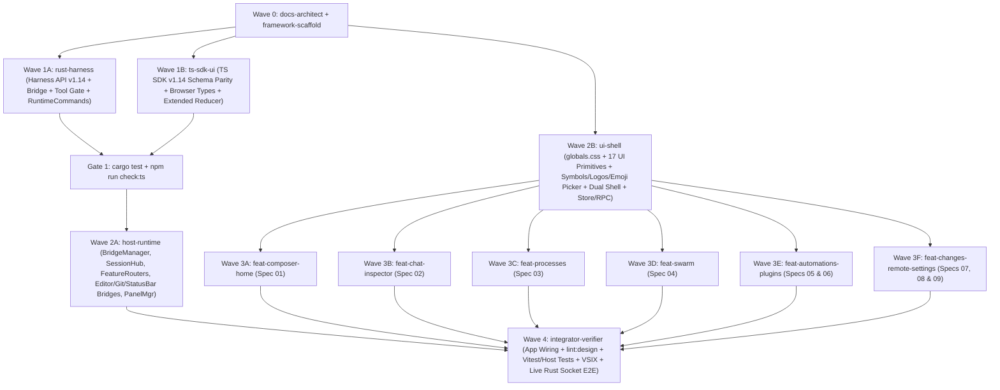

# RayuCode for VS Code — Parallel Swarm Execution Plan (`SWARM_WORKSTREAMS.md`)

> **Goal:** Execute the full production RayuCode VS Code Extension build across parallel waves with **zero file ownership overlap**, **strict verification gates**, and **100% isolation from `desktop/`**.

---

## 1. Execution DAG & Verification Gates



---

## 2. Disjoint Ownership Matrix (Zero Overlap)

| Wave | Worker | Exclusive Write Scope | Primary Input Specs |
| :--- | :--- | :--- | :--- |
| **0** | `docs-architect` | `vscode/VSCODE_DESIGN.md` (replaces deleted `vscode/DESIGN.md`), `vscode/docs/ARCHITECTURE.md`, `vscode/docs/PROTOCOL_CONTRACTS.md`, `vscode/docs/SWARM_WORKSTREAMS.md`, `vscode/docs/pages/00..09-*.md` | Master plan & Specs `00..09` |
| **0** | `framework-scaffold` | `vscode/package.json`, `vscode/vite.config.ts`, `vscode/vitest.config.ts`, `vscode/tsconfig.json`, `vscode/build.mjs`, `vscode/assets/{rayu-fox.png,app-icon.png,fonts/*}`, `vscode/shared/vscodeProtocol.ts`, `vscode/scripts/lint-design.mjs` | `ARCHITECTURE.md`, `PROTOCOL_CONTRACTS.md` |
| **1A** | `rust-harness` | `crates/rayucode-harness-api/**`, `crates/rayucode-harness-api-server/**`, `crates/rayucode-app-core/src/server/{runtime_commands,runtime_special_commands}.rs`, `crates/rayucode-app-core/src/tool/mod.rs`, `crates/rayucode-app-core/src/agent/prompting.rs` | `PROTOCOL_CONTRACTS.md` §1 |
| **1B** | `ts-sdk-ui` | `sdk/typescript/src/{protocol,client,browser}.ts`, `sdk/typescript/test/**`, `packages/ui/src/state/sessionReducer.ts`, `packages/ui/src/adapter/**` | Wave 1A wire JSON shapes & tags |
| **2A** | `host-runtime` | `vscode/host/harnessExtension.ts`, `vscode/host/runtime/**`, `vscode/host/bridges/**`, `vscode/host/panel/workspacePanelManager.ts`, `vscode/extension.manifest.json`, `vscode/test/**` | Gate 1 + `vscodeProtocol.ts` |
| **2B** | `ui-shell` | `vscode/webview/src/styles/globals.css`, `vscode/webview/src/lib/**`, `vscode/webview/src/components/ui/**`, `vscode/webview/src/features/shell/**` | `VSCODE_DESIGN.md` + Spec `00` |
| **3A** | `feat-composer-home` | `vscode/webview/src/features/composer/**`, `vscode/webview/src/features/chat/HomePage.tsx` | Spec `01` + Wave 2B barrels |
| **3B** | `feat-chat-inspector` | `vscode/webview/src/features/chat/**` (excl. `HomePage.tsx`), `vscode/webview/src/features/inspector/**` | Spec `02` + Wave 2B barrels |
| **3C** | `feat-processes` | `vscode/webview/src/features/processes/**` | Spec `03` + Wave 2B barrels |
| **3D** | `feat-swarm` | `vscode/webview/src/features/swarm/**` | Spec `04` + Wave 2B & 3B barrels |
| **3E** | `feat-automations-plugins` | `vscode/webview/src/features/automations/**`, `vscode/webview/src/features/plugins/**` | Specs `05` & `06` + Wave 2B barrels |
| **3F** | `feat-changes-remote-settings` | `vscode/webview/src/features/changes/**`, `vscode/webview/src/features/remote/**`, `vscode/webview/src/features/settings/**` | Specs `07`, `08` & `09` + Wave 2B barrels |
| **4** | `integrator-verifier` | `vscode/webview/src/{main,App}.tsx`, `vscode/README.md`, `docs/PRODUCT_VSCODE_DEV.md` | All waves — full wiring, verification, VSIX & live E2E |

---

## 3. Mandatory Wave Exit Gates

### Gate 0 — Docs & Scaffold Ready
- `vscode/VSCODE_DESIGN.md`, `vscode/docs/{ARCHITECTURE,PROTOCOL_CONTRACTS,SWARM_WORKSTREAMS}.md`, and `vscode/docs/pages/00..09-*.md` are present; legacy `vscode/DESIGN.md` is removed.
- `vscode/assets/{rayu-fox.png,app-icon.png,fonts/*.woff2}` are staged.
- `vscode/shared/vscodeProtocol.ts`, `vscode/scripts/lint-design.mjs`, `vscode/vite.config.ts`, `vscode/vitest.config.ts`, and `vscode/package.json` are installed and parse cleanly.

### Gate 1 — Rust Harness API `v1.14` & TS SDK Schema Parity
```bash
cargo test -p rayucode-harness-api -p rayucode-harness-api-server
cargo test -p rayucode-app-core --lib runtime_commands
cargo test -p rayucode-app-core --lib tool::
npm run check:ts
```

### Gate 2 — Host Runtime & Webview Design System Shell
- Wave 2A (`host-runtime`): Host compiles cleanly via `esbuild` and all `vscode/test/**` unit/integration tests pass.
- Wave 2B (`ui-shell`): `globals.css`, all 17 Radix/shadcn primitives, `RayuProcessingMark`, `TechFileBadge`, `RayuSymbols`, `ProjectIconPicker`, dual-surface `AppShell`, and `lib/*` pass `typecheck` and `lint:design`.

### Gate 3 — Feature Slices (Waves 3A–3F)
- Every feature slice exposes a clean `index.ts` barrel, imports other features **only** via `@/features/<name>`, passes `typecheck`, `lint:design` (0 hex, 0 `bg-[#...]`, 0 zinc/slate/gray, 0 UI emojis), and includes focused Vitest component/logic tests.

### Gate 4 — Final Integration, VSIX Packaging & Live Rust Socket E2E
```bash
# 1. Full automated test & packaging gate
npm run typecheck --workspace @rayu-dev/rayucode-vscode
npm run lint:design --workspace @rayu-dev/rayucode-vscode
npm test --workspace @rayu-dev/rayucode-vscode
npm run build:vscode
npm run package:vscode

# 2. Live isolated Rust daemon + api-bridge verification (does not disturb shared daemon)
cargo build --profile selfdev
# Launch isolated daemon + bridge against temp sockets (/tmp/rayu-vscode-test.sock, /tmp/rayu-vscode-api.sock)
# Verify: hello v1.14 capabilities, set_permission_mode + risk_tier approval, Alt+B background_tool
#         + RuntimeCommand::Background, and live responses for all RuntimeCommands.

# 3. Interactive VS Code Extension Development Host verification
code --extensionDevelopmentPath="$PWD/vscode/dist/extension" /home/rayu/rayu/rayucode-v2
```

---

## 4. Non-Negotiable Worker Guardrails

1. **Strict Ownership:** Never modify files outside your assigned scope in Section 2.
2. **Protect `desktop/` & Unrelated Files:** Never touch `desktop/`, `RELEASING.md`, or `bug.md`.
3. **Zero Static Prototypes:** All VS Code UI lives in pure React 19 + Tailwind CSS v4 + Radix UI (`vscode/webview/src/`).
4. **Honest Runtime Integration:** Never hardcode model allowlists or fake live backend state — wire every control to `vscode/shared/vscodeProtocol.ts` and Rust Harness API `v1.14`, with graceful capability checks for `v1.13`.
5. **Clean Completion Reports:** Post `@coordinator [done] <concise summary of files changed, wire shapes/exports, and verification command results>` when finished.
