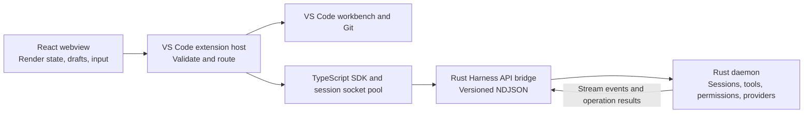

# VS Code React and Rust Engine Integration Audit

The VS Code 3.0.2 extension has a functioning Rust-backed path for core sessions, history, permission changes, configuration and file-change snapshots. The highest-priority defect is a legacy **Undo** path that can discard manual edits. Swarm, Automations and Feedback can display actions as successful when the host explicitly rejected them. **Fork from this turn** clones the entire session, including later messages. The [RPC test matrix](VSCODE_RPC_TEST_MATRIX.md) gives an individual acceptance case for every typed RPC.

Audit baseline is commit `ee8d63a` on November 28, 2026. The packaged extension runs `host/harnessExtension.ts` and the React app rooted at `webview/src/main.tsx`. The older extension and webview entry files are outside the packaged path. [Build entry points](../build.mjs) · [Extension manifest](../extension.manifest.json)

## What the extension exposes

| Inventory | Count | Scope |
| --- | ---: | --- |
| React route IDs | 9 | Home, Workspace, Plugins, Settings, Swarm, Agents, Automations, Remote and Changes |
| Main React page destinations | 4 | Home, Workspace, Plugins and Settings. Four route IDs select sections inside Settings. Changes falls back to Workspace or Home. |
| Settings sections | 11 | Account, Appearance, Models, Features, Agents, Swarm, Automations, Remote, Safety, Runtime and Shortcuts |
| Supplemental surface groups | 3 | Auth/offline gate, background process dock and drawer, native VS Code editor/diff/terminal/browser affordances |
| Typed webview-to-host RPC methods | 189 | 164 have a React source call site, including dynamic MCP Add/Edit. The other 25 have host handlers and no identified React RPC call site. A source call site can belong to an unmounted component. |
| Webview-to-host message types | 19 | Includes the RPC envelope, raw Harness envelope and native workbench actions |
| Raw Harness verbs emitted by React | 3 | `send_message`, `cancel`, `set_model`. Other engine operations usually travel through typed RPC. |
| VS Code contribution commands | 34 | Command Palette, context menus, editor/view/SCM title, status menu and keybindings |
| Rust Harness wire types | 57 requests, 61 events | One additional unknown sentinel exists for each enum. VS Code uses a subset. |

The count uses distinct protocol operations and public commands. Repeated buttons, callbacks, tabs and React helper functions share these operations. The matrix includes the declared routes without React callers so they can be tested directly or removed deliberately. [React destinations](../webview/src/App.tsx#L439) · [Settings sections](../webview/src/features/settings/components/SettingsView.tsx) · [RPC schema](../shared/vscodeProtocol.ts#L2664) · [Host message routing](../host/panel/workspacePanelManager.ts#L870) · [Rust requests](../../crates/rayucode-harness-api/src/requests.rs) · [Rust events](../../crates/rayucode-harness-api/src/events.rs)



The extension has two write paths. Typed RPC validates UI parameters and host-produced results with Zod. Raw Harness messages use a generic object envelope, are normalized by SessionHub, and return through the frame stream. The host maintains per-session sockets and converts Rust frames into UI state and broadcasts. Git index operations, clipboard, editor navigation and local workbench preferences use native APIs. Workspace grouping, pinning, archive filtering and some composer preferences also have host persistence. [RPC client](../webview/src/lib/rpc-client.ts#L124) · [SessionHub](../host/runtime/sessionHubCore.ts#L2261) · [Bridge translator](../../crates/rayucode-harness-api-server/src/translate.rs) · [SDK](../../sdk/typescript/src/client.ts)

### RPC count by domain

| Domain | Declared | React call site |
| --- | ---: | ---: |
| Daemon | 8 | 8 |
| Workspace | 17 | 9 |
| Sessions | 24 | 22 |
| Background | 6 | 6 |
| Swarm | 12 | 11 |
| Automations | 21 | 20 |
| Plugins | 26 | 24 |
| Changes | 13 | 8 |
| Remote | 17 | 16 |
| Settings | 36 | 36 |
| Inspector | 6 | 1 |
| Capabilities | 1 | 1 |
| Config | 2 | 2 |
| **Total** | **189** | **164** |

## Findings and proposed fixes

Priorities reflect user impact. **Reproduced** means a current implementation was exercised with an isolated Rust or Git fixture. **Code-confirmed** means the relevant UI and host paths establish the behavior. **Regression target** identifies a scenario requiring a packaged or provider-backed run.

### P0 Manual edits can be lost through legacy Undo

**Reproduced.** With the Rust file-change operation unavailable, the router falls back to `GitChangesBridge.undo`. With no session baseline, the bridge generates a patch from HEAD to the current file and reverses that entire patch. A disposable fixture containing only a manual edit returned success and removed the edit. The packaged host has no caller for the Git bridge’s session-baseline recorder. The same fallback can delete an untracked file by treating empty HEAD content as the baseline. Restrict agent Undo to an attributable engine snapshot or verified legacy session baseline. Keep whole-file Git revert as an explicitly separate native action with its own confirmation. For Undo All, report every file result and preserve manual edits throughout. [Route and fallback](../host/runtime/featureRouters.ts#L3994) · [Git baseline and undo](../host/bridges/gitChangesBridge.ts#L426)

### P1 A rejected Swarm operation can create phantom state

**Reproduced at the host boundary and code-confirmed in React.** The production router returns RPC-envelope success with inner `ok: false` for spawn, rename, kill, salvage, pause-all, plan decisions and DM. Several hooks treat a resolved call as success. Spawn can insert fabricated worker and coordinator records and paths. Plan and worker mutations can rewrite cached state despite rejection. The isolated daemon accepts `swarm status` and rejects `swarm spawn` through the current runtime command. Rust already has swarm-tool and server coordination paths, so evaluate those for typed, authenticated mutations with group, worker and proposal IDs. Until the appropriate operation is advertised and implemented, gate the corresponding control and leave the engine-backed state intact. [Host Swarm routes](../host/runtime/featureRouters.ts#L2704) · [React spawn result handling](../webview/src/features/swarm/hooks/useSwarm.ts#L375) · [React plan handling](../webview/src/features/swarm/hooks/useSwarm.ts#L661) · [Rust runtime Swarm branch](../../crates/rayucode-app-core/src/server/runtime_commands.rs#L256)

### P1 Automations and Feedback can show success without an operation

**Reproduced at the host boundary and code-confirmed in React.** Overnight Pause and Run Now and Schedules Toggle and Run Now return inner failures. Their hooks mutate the row or its counters on resolution. The live daemon rejects the probed `overnight run_now` and `schedules enable` arguments. Feedback also returns inner failure while Settings shows a submitted message. Make mutation handling consistent for transport failures and operation-level rejection. Gate unsupported automation controls, add typed mutations for the supported product actions, and use a feedback receipt before clearing or confirming a submission. [Automation stubs](../host/runtime/featureRouters.ts#L2918) · [Schedule stubs](../host/runtime/featureRouters.ts#L3113) · [React mutation handlers](../webview/src/features/automations/hooks/useAutomations.ts#L156) · [Feedback handler and UI](../webview/src/features/settings/hooks/useSettings.ts#L1772) · [Feedback host stub](../host/runtime/featureRouters.ts#L5490)

### P1 Inline diff decisions can diverge from the actual files

**Code-confirmed.** Inline Accept and Reject update the card before the RPC and ignore both rejected requests and inner failures. Its Undo resets the badge locally. It does not reverse the prior file decision. This component is rendered in both ChatStream and WorkTrace. Use the same acknowledged Keep/Undo/Redo state and conflict UI as the turn file summary. Test all three states against a fresh engine snapshot and actual file bytes, including a bridge drop after submission. [Inline decision handlers](../webview/src/features/chat/components/InlineDiffCard.tsx#L52) · [Turn file summary](../webview/src/features/chat/components/TurnFileSummaryCard.tsx#L397)

### P1 Fork from this turn keeps later history

**Reproduced.** The turn button sends `atTurnId`, the webview contract accepts it, and the host calls the full-session fork operation without a boundary. The Rust request takes only a session ID. A live fork carrying an extra boundary field kept both context messages when its child was attached. Add an optional, capability-gated Rust fork boundary with a stable engine message/turn identity, and preserve the full-session menu action. Hide the historical action on engines without that capability or label it as a full-session fork. [Turn action](../webview/src/features/chat/components/TurnActions.tsx#L89) · [Host router](../host/runtime/featureRouters.ts#L2178) · [Rust fork shape](../../crates/rayucode-harness-api/src/requests.rs#L117)

### P1 Session settings can diverge from the engine on submission

**Code-confirmed.** Session creation persists and broadcasts the requested permission mode after swallowing a failed Rust write. A later failed permission change can leave its requested mode saved because the host writes preferences before applying it. A pending permission write is removed before retry and send continues on failure. Create and Send carry tier/TTL in local preferences but do not apply them through that send path. Separate requested, pending and acknowledged settings. Require permission acknowledgement before automatic execution under the requested mode. Apply supported model/effort/tier/TTL through the canonical engine scope and report partial application. Rust currently treats cache TTL as an Anthropic setting for subsequent calls. [Create path](../host/runtime/sessionHubCore.ts#L1743) · [Mode mutation](../host/runtime/sessionHubCore.ts#L1982) · [Send path](../host/runtime/sessionHubCore.ts#L2451) · [Rust cache semantics](../../crates/rayucode-app-core/src/server/runtime_commands.rs#L214)

### P1 Multiple sessions can disagree about workspace and file context

**Code-confirmed paths, packaged regression target.** Queue drain takes working directory from the UI’s currently active project, even when sending to another session. The host may then attach the target session to that project’s ledger while the Rust session keeps its own cwd. Native `openFile` resolves relative paths using the host-wide active session and its message carries no session ID. Git bridge defaults to the first workspace folder for actions without explicit roots. Capture session and worktree identity when the action is created. Resolve and validate it at the host boundary. Test two worktrees containing the same relative paths and verify both their ledgers and files. [Queue drain](../webview/src/App.tsx#L385) · [Host ledger update](../host/runtime/sessionHubCore.ts#L2449) · [Native file open](../host/panel/workspacePanelManager.ts#L928) · [Git root wiring](../host/harnessExtension.ts#L122)

### P1 Connector and skill creation can overwrite existing files

**Reproduced.** MCP Add treats malformed configuration as an empty object and overwrites the file. Edit delegates to Add and replaces the selected entry. Add/Remove also ignore a rejected engine reload before returning success, so on-disk config and active tools can diverge. Creating a second skill with the same normalized name silently overwrites its existing `SKILL.md`. The fixture reproduced both overwrites. Reject invalid baselines and duplicate creation, merge explicit edits against the original entry, scope to the selected workspace, and write atomically. Report the outcome of saving and reloading separately. [MCP config write](../host/runtime/featureRouters.ts#L3408) · [MCP edit and remove](../host/runtime/featureRouters.ts#L3513) · [Skill create](../host/runtime/featureRouters.ts#L3631)

### P2 Changes and Inspector have incomplete UI entry points

**Code-confirmed.** Both contributed Changes commands already invoke native VS Code Source Control. The compatibility route named `changes` resolves to Chat Workspace when a session is active and Home otherwise. Inline changes are available through chat, while the standalone stage/unstage, commit and PR operations have no React RPC call site. The proposed session inspector has backend side-panel/applet operations and cache with no matching React caller. Todos are an exception. The supported-path repair keeps the current native commands and the Chat review and todos. Verify command routing in the packaged workbench. [Route switch](../webview/src/App.tsx#L499) · [Changes commands](../host/harnessExtension.ts#L519) · [Inspector methods](../host/runtime/featureRouters.ts#L5498) · [Changes spec](pages/07-changes.md) · [Inspector spec](pages/02-chat-and-inspector.md)

### P2 Empty or stale data can masquerade as authoritative state

**Code-confirmed.** Session listing catches errors and returns an empty list. Runtime reads commonly map failure to an empty object. Context maps that to zero usage with a 200,000-token placeholder. Account analytics always returns zero and Workspace integrations always return static disconnected states. Render distinct loading, live-empty, stale and failed states. Report source and age for cached data. For analytics and integrations, connect an actual backend or render an unavailable state. [Runtime read helper](../host/runtime/featureRouters.ts#L1550) · [Context mapping](../host/runtime/featureRouters.ts#L2005) · [Session list catch](../host/runtime/featureRouters.ts#L2086) · [Workspace status](../host/runtime/featureRouters.ts#L3760) · [Analytics stub](../host/runtime/featureRouters.ts#L4758)

### P2 Live model changes may not reach an open picker

**Code-confirmed invalidation gap, provider-backed regression target.** The Rust bridge produces catalog events, but React’s model refresh paths watch init, account, daemon and config changes plus explicit refresh. There is no production webview handler for a standalone `models` push in this source. The refresh RPC returns success if either the daemon refresh succeeds or the hosted model list is nonempty, including a returned last-good list, so stale fallback can appear to be a successful refresh. Publish scoped model updates into all active pickers. Distinguish fresh success, stale retention and failure. Verify endpoint-scoped caches, forced refresh over a fresh cache, future model IDs and last-good behavior. [Bridge translation](../../crates/rayucode-harness-api-server/src/translate.rs#L3624) · [App query invalidation](../webview/src/App.tsx#L122) · [Refresh router](../host/runtime/featureRouters.ts#L5156) · [Hosted model cache](../host/auth/rayuHostAuthManager.ts#L1007)

### P2 Other visual controls can imply more support than the runtime exposes

**Code-confirmed.** MCP browser/copy actions are host-owned, while OAuth login/logout stubs reject. Skill install and Run and memory fact mutations are also stubbed. Runtime memory status exposes enabled/activity/pipeline state, so the fact graph needs an actual fact data source. Cloud move/return/attach/sync are unsupported in this host. Self-Dev Build/Reload buttons invoke unsupported actions. Voice settings persist local values and there is no mounted composer microphone capture path. Separate operation capabilities from broad capability names such as `swarm_control` and `mcp_control`, and show actual availability at each screen. [MCP and skills](../host/runtime/featureRouters.ts#L3578) · [Memory operations](../host/runtime/featureRouters.ts#L3683) · [Rust memory status](../../crates/rayucode-app-core/src/server/runtime_commands.rs#L232) · [Cloud operations](../host/runtime/featureRouters.ts#L4494) · [Self-Dev handler](../host/runtime/featureRouters.ts#L1866) · [Voice preference handler](../host/runtime/featureRouters.ts#L5357) · [Bridge capabilities](../../crates/rayucode-harness-api-server/src/lib.rs#L444)

### P2 Engine version display uses the SDK version

**Code-confirmed.** BridgeManager sets the displayed protocol version from SDK constants. The SDK stores the server name and advertised capability flags after hello. A connected older server can therefore be reported as the client’s minor version. Use server-advertised protocol metadata when present and capability gates when it is unavailable. Test current and previous bridge fixtures including a mixed old-daemon/new-bridge pairing. [Bridge status assignment](../host/runtime/bridgeManager.ts#L758) · [SDK hello handling](../../sdk/typescript/src/client.ts#L364)

### P2 VS Code archive state can disagree with CLI and Harness

**Code-confirmed ownership gap.** The VS Code archive mutation writes the workspace ledger and the VS Code listing filters it. Rust implements independent `archive_session` and `restore_session` operations. If Archive means shared session visibility, route it through Rust and migrate the VS Code flag with clear precedence. If the product intends local filtering, label it as local. Verify actions and readback in both directions. [VS Code archive route](../host/runtime/featureRouters.ts#L2199) · [Session listing](../host/runtime/sessionHubCore.ts#L1624) · [Rust archive API](../../crates/rayucode-harness-api/src/requests.rs#L91)

## Screen and control test plan

Use the [RPC matrix](VSCODE_RPC_TEST_MATRIX.md) for the operation underneath each screen test. Execute each listed interaction separately. For writes, observe the submitted ID and parameters, the reply or event, the rendered state, and a fresh read through the owning service. A native action uses a VS Code/Git assertion. A Rust action uses a new SDK read, fixture provider request capture, or a file/config assertion.

| Surface | Controls and states to exercise | Required result |
| --- | --- | --- |
| Workbench shell | Open sidebar, editor tab and beside; pop out and return; back/forward; compact drawer; expand/collapse; native browser and terminal; status menus | Correct view, column, focused session and cwd. Open once, preserve draft, restore on window reload, maintain keyboard and screen-reader focus. |
| Shell appearance | VS Code light/dark/high contrast, explicit light/dark/VS Code theme, green/blue accent, density, reduced motion | Correct tokens on both surfaces after theme and zoom change, persisted settings across panel reload. |
| Workspace and sessions sidebar | Folder/project list and icon, group collapse, pin/archive/restore, search and source filters, rename, fork, selected session and history | Correct project, session and ordering in two roots with duplicate display names. Exercise 201+ results, offline error, and external sessions with identical short IDs. |
| External import dialog | Source selection, project groups, select all/individual, preview, import, unselect/cancel, duplicate import, force resync and fork on conflict | Source IDs and canonical IDs match actual Rust records. Report skipped imports, preserve predecessor and keep selection on failure. |
| Auth and offline gate | OAuth browser and loopback, sign-up/external link, cancel/reopen/copy link, manual callback, API key, Continue/Open workspace, runtime restart/install and doctor | Correct account state and route availability. Open workspace can reach sign-in/settings with no credential. Expired or failed auth never silently signs in. |
| Home | Quick-action cards, new draft, recent sessions, resume/search, project selection, branch display, pending first-submit and recovery | Draft creation does not create duplicate Rust sessions. One submission creates one engine session in the selected directory. Restore text and attachments after a refused create/send. |
| Composer text entry | Send button, Enter, Shift+Enter, IME composition, paste, multiline, blank, rapid repeat, and native auto-submit versus prefill | Only intentional submission reaches Rust. Input and caret survive keyboard menus, resize, and pre-submit error. |
| Composer references | File and skill suggestions, workspace search, selection pill add/remove/open, drag/drop and paste paths/images, unsupported/oversize images | Real file identity and working directory match. Assert the exact provider payload and attachment names, bytes and MIME. Check an unsaved editor selection with a saved on-disk version that differs. |
| Composer commands | Slash suggestions, local navigation/clear actions, capability-provided commands, skill entry, arguments, invalid and unsupported commands | Compare each advertised command with Rust dispatcher result. Pure UI commands stay in React. Restore input when the engine rejects. |
| Composer inference and permissions | Provider/model/effort selection and refresh, provider filters, service tier, cache TTL, permission modes and context/compact controls | Actual engine/model request matches labels. Test all advertised combinations, fresh/warm refresh, missing credential, busy next-turn changes and unsupported modes. |
| Composer during generation | Steer, Queue, alternate keyboard shortcut, edit/remove queued message, promote to Steer, send now, cancel one/all steering IDs, Stop and retry | FIFO and per-session identity match. Run A/B concurrently, switch project, disconnect at enqueue and later reconnect. Confirm messages exactly once, cancellation scoped and cancelled queue does not drain unexpectedly. |
| Chat transcript | Live answer, text replacement, reasoning, cancellation/error, reload/resume, initial loading, empty history, scroll/back-to-bottom | Render correct order with live and stored overlap, no duplicated text/turn, no event leakage into inactive or unrelated sessions. |
| Chat tools and artifacts | Tool group expand/collapse, safe shell output/copy/background, code copy/insert/diff, actual file citation, native preview, markdown and media | Correlate tool ID, result, owning turn, image/MIME and target path. Test tool failure, long output, missing file and same-name paths in two worktrees. |
| Chat approval | Pending permission stack, allow, allow always, deny, next request and dismissal/settlement | Card tracks engine request lifetime. Trigger two safe tool approvals, resolve from different surfaces, assert same ID and one result. |
| Chat clarifying questions | Single/multiselect, free text and notes, submit, decline, close from second surface, repeated click | Card reflects exact engine result and lifecycle. Pending questions and permissions remain independent. |
| Chat turn actions | Copy, pin, export, retry, full fork, fork at a turn, rewind and undo rewind | Verify previous and next turn IDs, selected engine history or file state and cross-session isolation. Assert whether pin is local in product contract. |
| Chat file changes | Inline accept/reject/reset, per-turn summary, expand diff, native diff, Keep/Undo/Redo one/all, conflict Cancel/Open Diff/Force Restore | Compare pending/kept/undone snapshot and actual bytes. Include manual dirty edits, untracked/deleted/renamed/binary/large files and old/no capability. |
| Changes route | Command Palette and SCM launch with and without active session; Git/session scope, stage/unstage, commit, PR dialog | Currently reaches chat or Home. Acceptance depends on intended destination. If restored, require correct repo, native diff, real index and explicit PR confirmation. |
| Session inspector | Session todos, side panel pages, applet state/action and close | Todos reflect Rust. The other operations need direct router coverage and a mounted entry point if retained in the product. Include A/B and live changes from another client. |
| Background UI | Dock counts, drawer, filters/grouping, expand task, tail output, copy/open log, cancel, cleanup and return | Running/stalled/done/failed states, max bytes, native log path, realtime updates and unchanged tasks in another session. |
| Plugins MCP | Browse/search/filter connectors, featured/detail view, reload/test/toggle, Add/Edit/Remove dialog, connect/auth actions, open/copy link | Test each transport, scope, cancel, invalid/duplicate input, and Rust reload status. Protect unrelated config and show unsupported OAuth honestly. |
| Plugins Skills | List/scope filter/search, reload, create, inspect/open file, install, Run and composer selection | Verify actual SKILL.md path and new discovery. Test unsupported buttons and fresh picker state. |
| Plugins Memory | Enable, extraction, search/filter, graph selection, remember/forget/tag/link, state after restart | Compare actual Rust features, extraction lifecycle and persisted facts/relationships. Unsupported actions may not modify the UI graph. |
| Plugins Workspace | Gmail, Calendar, Browser, Companion status and each action; any action exposed from shell | Use fixtures for availability, counts and actions, with explicit unavailable state where no backend exists. |
| Settings navigation | All 11 sections, search/no results, category scroll, collapse/expand rail, back to workspace, direct host navigation | Same route in compact/wide variants. Settings query errors should not strand embedded sections that can work independently. |
| Settings Account | Profile, refresh, sign-in methods, cancel, sign-out, pacing, provider key add/clear/logout, usage range/grouping | Correct readiness/credits, cross-surface invalidation, real analytics or unavailable, and no credential text in browser logs or events. |
| Settings Appearance | Theme, accent, density, reduce-motion, editor title icon, open location and context auto-submit | Native persisted settings apply immediately and after restart. Verify command entry behavior and local preference indicators. |
| Settings Models | Default route/effort, refresh, tier, cache TTL, role overrides, provider filtering and config links | Confirm exact endpoint, auth, role scope, next request and CLI-driven change. Retry failure without discarding last good entries. |
| Settings Features | Every exposed feature, tool flags, voice support/device/noise/auto-send, configuration sync | Compare Rust config and effective capabilities. A local preference must not imply active recording. |
| Settings Agents | Review/judge role overrides, subagent model, global vs session profiles, create/edit/delete, refresh and engine model selection | Check persisted scope and the model used by the next fixture worker. Include conflicting names and unsafe/invalid input handling. |
| Settings Swarm | Presets, custom worker form, label/model/worktree, group switch, roster, inspector, task/feed/plan, DM, stop, salvage and pause all | Every write must return an engine ID/result or leave state unchanged with clear failure. Worktree opens once and correct worker transcript stays scoped. |
| Settings Automations Overnight | Launch with duration/mission, filter rows, open log/report, expand handoff, pause/resume/run now/cancel | Compare real manifest, log and validation counters. Test expiry, non-running run and actionable unsupported controls. |
| Settings Automations Schedules | Create each exposed recurrence/one-off variant, time zone, filter, toggle, run now and cancel | Verify saved IDs, computed next run, scheduler execution/failure and matching state after restart. |
| Settings Automations Ambient/Quality | Inbox, approvals allow/deny, auto-review, auto-judge, run review/judge, productivity range and report link | Verify durable approvals, actual worker/report IDs, independent flags and correct date bounds. |
| Settings Remote Telegram | Hosted pairing and QR/copy, bot token flow, disconnect, ping, drive session, uninstall preference and approval decisions | Fixture service validates expiry, correct bot and target session, secret redaction and durable decisions. |
| Settings Remote Cloud/Gateway | Status, pairing QR/copy, toggle, revoke, SSH status, move/return/attach/sync actions | Compare actual device and session IDs. Unsupported actions leave engines and UI state untouched. |
| Settings Safety | Default permission radio, effective mode, optional apply, hook list/open config, invalid config/reload notices | Verify effective state against Rust per session. Test missing/incompatible engine, stale state and preservation on rejected apply. |
| Settings Runtime | Status/ping, reconnect/reload/restart/update/output, binary path/socket and auto-start, transport, provider/auth doctor, Self-Dev, telemetry, feedback | Verify real process identity, setting scope, operation outcomes, telemetry config and truthful feedback receipt. |
| Settings Shortcuts | Platform labels, open keybindings, override/conflict and focus | Compare to contributed IDs and actual keyboard behavior in macOS, Windows and Linux. |

For each mounted screen, test compact (<560 px), medium (560–959 px), and wide (960 px and up), especially both sides of each breakpoint. Run at least one VS Code light, dark and high-contrast pass. Cover keyboard-only navigation, Escape/Enter, accessible names, focus after dismissal, and no clipped controls in a narrow sidebar. Validate loading, empty, ready, failed, disconnected, disabled, and incoming stale-data states wherever applicable.

## Native command and message coverage

All 34 contribution commands have a separate workbench acceptance assertion below. Test each command from its actual entry point as well as dispatch by command ID. Exercise menu conditions and keybindings from the manifest. [Manifest](../extension.manifest.json) · [Registration](../host/harnessExtension.ts#L475)

| Command suffix, prefixed by `rayucode.` | Test |
| --- | --- |
| `openFromEditorTitle` | Open from the editor fox icon and keyboard under each of the three settings locations. Preserve active document. |
| `openBeside` | Open in adjacent group and reuse existing Rayu panel when appropriate. |
| `openSidebar` | Focus the Rayu secondary sidebar without changing the user’s currently selected session unexpectedly. |
| `openWorkspacePanel` | Open the editor panel with expected initial route and restore previous focus when it closes. |
| `openSwarm` | Select Settings Swarm from cold startup and an existing window. |
| `openAgents` | Select Settings Agents and hydrate the global/session scope. |
| `openAutomations` | Select Settings Automations and show the expected first tab. |
| `openPlugins` | Open Plugins and its configured default tab. |
| `openBackgroundProcesses` | Open drawer via palette and Alt/Option+Shift+B for the right session, including idle. |
| `openTerminal` | Open integrated terminal in the requested or session cwd. |
| `openBrowser` | Open VS Code simple browser with approved destination or URL prompt, and cancel once. |
| `openChanges` | Check declared Changes destination with active/idle state and correct session identity. |
| `scmOpenChanges` | Trigger from SCM in workspace B and verify the correct repo and intended Changes destination. |
| `reviewGitDiff` | Review fixture staged/unstaged changes in selected repo. Assert exact injected prompt and no unintended submit. |
| `draftCommitMessage` | Draft for staged fixture, empty index and cancel. Confirm command never commits automatically. |
| `openRemote` | Select Settings Remote and verify tabs. |
| `openSettings` | Open Settings with existing draft/session still recoverable. |
| `newSession` | Open and focus a new draft, preserving prior active session and avoiding premature creation. |
| `resumeSession` | Focus search and open the selected persisted session once. |
| `sendSelection` | Add selected range and mention, including unsaved file, then inspect actual prompt and originating root. |
| `addToContext` | Add Explorer multi-selection and editor resources with space/Unicode paths and deduplicate. |
| `askAboutResource` | Prefill selected resource from Explorer and editor tab, using correct root and no unwanted submit. |
| `explainSelection` | Use current selection/lines and switch auto-submit on/off. |
| `refactorSelection` | Prefill exact scope and run once when requested. Verify no duplicate action across surfaces. |
| `generateTestsForSelection` | Prefill actual selected content and targeted testing intent. |
| `fixDiagnostic` | Run actual Quick Fix on fixture diagnostics, preserving message, range and repo. |
| `explainDiagnostic` | Invoke diagnostic action and verify the diagnostics and selection are present in the prompt. |
| `askTerminal` | Capture selected terminal output and cwd, restore clipboard when used, handle no selection. |
| `fixTerminalError` | Use captured error in active terminal and check auto-submit setting/cancel. |
| `reloadDaemon` | Reload isolated engine and bridge, then verify version, session reattachment and error handling. |
| `updateEngine` | Drive fixture install/update with progress, failure and old-binary availability. |
| `statusBarAction` | Open menu for signed in/out and connected/offline. Verify each displayed route calls the intended command. |
| `signIn` | Open legitimate browser or loopback auth flow, test cancel and verify status event in both surfaces. |
| `signOut` | Verify confirmation, cancel and completed sign-out with updated provider/catalog state. |

| Webview-to-host envelope | Test |
| --- | --- |
| `rayucode.webview.ready` | Check init snapshot and order versus queued native navigation and composer injections on cold start/revive. |
| `rayucode.rpc.call` | Match all schema methods to host handlers, validate payloads before calls, correlate replies and assert inner rejection, timeout, unknown method and result schema mismatch. |
| `rayucode.harness.request` | Validate raw request identity and frame normalization. Reject unknown verbs safely, correlate replies and make failures visible. |
| `rayucode.ui.openEditorPanel` | Open and revive with exact route/session and beside flag. |
| `rayucode.ui.focusSidebar` | Focus the existing sidebar with no duplicate surface. |
| `rayucode.ui.setAppearance` | Persist all appearance values and broadcast final settings. |
| `rayucode.ui.setWorkbench` | Persist all workbench options and verify editor title/context behavior. |
| `rayucode.editor.openFile` | Open expected relative or absolute path/range in the correct root, including missing path and case/encoding variations. |
| `rayucode.editor.openDiff` | Resolve proper session/Git scope and show true original/modified content, rename, create and delete. |
| `rayucode.editor.insertCode` | Verify cursor insertion, replacement and diff preview against native editor document state. |
| `rayucode.editor.openTerminal` | Verify name and cwd from the originating session/worktree. |
| `rayucode.editor.openWorktreeWindow` | Create one actual new window for the verified worktree. |
| `rayucode.editor.openMarkdownPreview` | Preview the correct report/skill Markdown file when present, and show file error when missing. |
| `rayucode.editor.openSimpleBrowser` | Open fixture HTTP/HTTPS or prompt, cover cancel, malformed and unsupported URI. |
| `rayucode.editor.openExternal` | Use native external link opening for approved schemes and reject unsupported URLs. |
| `rayucode.editor.copy` | Confirm selected code/run link/answer reaches clipboard with the expected text and error behavior. |
| `rayucode.dialog.pickFiles` | Direct host test for multi-selection/filter/cancel and matching requestId in filesPicked. |
| `rayucode.dialog.pickFolder` | Direct host test for single folder/cancel and matching requestId. |
| `rayucode.host.copyToClipboard` | Verify the alternate clipboard envelope for export and pairing. |

## Rust session and stream verification

Use current Rust wire fixtures from `requests.rs` and `events.rs` for the real bridge. The three rows below cover direct webview verbs. The remaining rows cover families of inbound events and readbacks used by the extension. SDK-only wire commands outside the extension’s surface remain under Rust/SDK contract tests.

| Contract | Acceptance |
| --- | --- |
| Raw `send_message` from Home, Workspace and retry | Send known prompt/images once. Assert engine acceptance and request correlation before final turn projection. Test busy/refused send and timeout without losing draft, attachments or turn identity. |
| Raw `cancel` | Cancel A during text and during a tool while B runs. Check Rust terminal events, truthful UI state and queued/steered messages. |
| Raw `set_model` | Change selected route through Settings. Require engine confirmation, compare next provider request and visibly reject unsupported route without stale label. |
| Handshake and lifecycle | Check real hello capabilities, runtime info, ping, connected/disconnected/error/init, child readiness and version. Test invalid NDJSON, split/coalesced lines and old bridge version. |
| Session reads and writes | Compare attached, forked, renamed, history, external projects/imported and compacted receipts. Check edits and persisted state through a second client. |
| Turn identity and replay | Use monotonic sequence and turn IDs when supplied. Test repeated frames, late frame from A while B is selected, two successive turns, history reconciliation and replay after reattach. |
| Text and reasoning | Verify text_delta, text_replace, text_done, reasoning deltas/done and final Markdown under burst, partial, empty and cancelled streams. |
| Tool lifecycle | Verify tool_call/start/input fragments/exec/done, output, permission refusal, binary/media artifact and matched call identity. Custom client tool frames need a documented policy and an SDK contract test where the webview does not render them. |
| User interaction | Verify permission_request/resolution, permission_mode_changed, question_request/closed and duplicate/stale responses after surface switch. |
| Mid-turn control | Verify message_accepted, soft_interrupt_injected/cancelled, background_tool_result, background_progress and wake request. Check same-session and cross-session ordering. |
| Termination and recovery | Verify connection_phase, session_status, session_recovery, turn_stopped, turn_done and scoped error. A reply to an unrelated control request cannot settle an active turn. |
| Usage and runtime | Verify token_usage, rayu_credits, kv_cache_miss, context_cap_changed, credential and catalog events with correct source, units and scope. |
| Configuration and files | Verify capabilities/config_state/config_changed, file-change state/diff/action results, todo state, side pane images, side-panel and applet state. Confirm app handles unknown events without corrupting state. |

## Fix sequence and release gates

1. **Protect working files.** Remove the HEAD fallback for agent Undo without a verified session snapshot. Bind file actions to session/worktree identity and unify all review cards with confirmed Rust receipts. Stop skill and connector creation from overwriting existing files. Add fixtures for old bridge, dirty edits, untracked files, malformed config, duplicates, conflicts and two roots.
2. **Make failures visible.** Normalize host mutation result handling, including inner failures. Gate known unsupported controls at the operation level. Give Swarm, Automations, Feedback, Cloud, MCP, Skills and Memory explicit acceptance criteria before exposing writes. Show stale/error states separately from zero or empty.
3. **Make the engine authoritative for execution.** Acknowledge permission/model/effort before use, preserve pending intent on failure, and test queue, settings and surface switching against actual session IDs. Add stable fork-at-turn to Rust/SDK/Harness with a capability gate.
4. **Resolve product navigation and feature ownership.** Restore or redefine Changes and Inspector entry points, verify the full manifest in an Extension Development Host, choose shared archive semantics, and reconcile displayed version, voice and analytics with actual capability.
5. **Close live catalog and parity coverage.** Add endpoint-scoped catalog fixtures and an explicit model-update push; run account, provider, external-session, runtime install and reconnect cases across long-lived clients.

### Test layers

- **Component tests.** Verify query states, actual dispatched IDs, and unsupported/error behavior with deliberately distinct transport failure and inner rejection. The browser mock should use Rust-shaped fixtures or match production router responses for unsupported operations.
- **Host contract tests.** Assert all 189 request schemas and handlers correspond, native command/message registrations are reachable, and actual host results agree with the matrix. A schema-valid result can still represent an operation failure.
- **Rust and SDK conformance.** Use an isolated `RAYU_HOME`, fixture repositories, separate daemon/API sockets, a source build and deterministic provider service. Validate the expected request, correlated Rust event, readback and persistent effect. Run current and previous capability sets.
- **Packaged VS Code tests.** Launch the built VSIX in an Extension Development Host with a disposable user-data and extensions directory, explicit engine path and API socket, and engine auto-update disabled for fixture runs. Test minimum supported VS Code and current, Linux/macOS/Windows, Remote SSH/WSL/Containers where supported, and trusted/untrusted workspace behavior. Run a separate fixture installer matrix for platform archives, auto-update and rollback.
- **Release gate.** Record test ID, build revision, platform, engine/bridge capability set, and sanitized evidence. Require one disposition for each RPC, each manifest command and each mounted screen. Approval, destructive Git changes, remote services and cloud cases use disposable local or dedicated test resources. A release cannot pass the parity gate with unresolved file-loss, false-success or session-misrouting defects.

### Local verification commands

Run from the repository root. The lower Vitest worker count kept the default timeouts reliable during the repeat run.

```bash
npm run build:vscode
npm run lint:design --workspace @rayu-dev/rayucode-vscode
npm run test:host --workspace @rayu-dev/rayucode-vscode
npm run test:webview --workspace @rayu-dev/rayucode-vscode -- --maxWorkers=2 --minWorkers=1
cargo test -p rayucode-harness-api -p rayucode-harness-api-server --lib
cargo build --profile selfdev --bin rayu
```

For a live contract run, allocate a disposable fixture root with separate `RAYU_HOME`, daemon socket and API socket. Start that binary with `--no-update --no-selfdev --socket <daemon-socket> -C <fixture-repo> serve -p rayu`. Start the API process with the same internal socket and `api-bridge --api-socket <api-socket> -p rayu`. For signed-out bootstrap use `RAYU_DEFERRED_AUTH_BOOTSTRAP=1`, as the extension does. Point the extension's `rayucode.apiSocketPath` at that API socket. For readback, connect a second SDK client to the same endpoint and check Rust state independently of the webview cache.

## Verification completed in this audit

| Check | Result |
| --- | --- |
| `npm run build:vscode` | Passed. TypeScript, the extension host and the bundled React webview built. Rollup emitted annotation warnings in dependency code. |
| `npm run lint:design --workspace @rayu-dev/rayucode-vscode` | Passed. 138 files checked, zero violations. |
| VS Code extension host tests | 60 passed. |
| VS Code webview tests | Default parallel run had seven failures. With two maximum workers and one minimum worker, all 138 tests across 18 files passed. React `act(...)` warnings still appeared. |
| `cargo build --profile selfdev --bin rayu` | Passed; the isolated probe used that output. |
| `cargo test -p rayucode-harness-api -p rayucode-harness-api-server --lib` | 275 passed across the Rust Harness API and bridge. |
| Real Rust smoke | Separate daemon/API sockets and temporary state. Hello, ping, list, capability discovery, get/patch config, create/attach, permission mode, history, runtime info/context, Swarm status and file-change snapshot responded. Used context-only messages without calling an inference provider. |
| Extension host with real SDK/Rust | Capabilities, config and file summary mapped to valid host results. Swarm Spawn, Schedules Toggle and Feedback returned an outer success with an inner rejection. |
| Targeted regressions | Real bridge retained both messages when asked to fork with an extra historical boundary. Legacy file undo removed a manual-only fixture edit. Host MCP Add replaced malformed fixture config and duplicate skill creation replaced an existing fixture skill file. |

The audit did not run the packaged UI in VS Code or use authenticated provider, OAuth, Telegram, cloud, or remote fixtures. Those are execution steps in the screen plan. The counted source inventory excludes internal Rust helpers, old UI entry points and Desktop.
